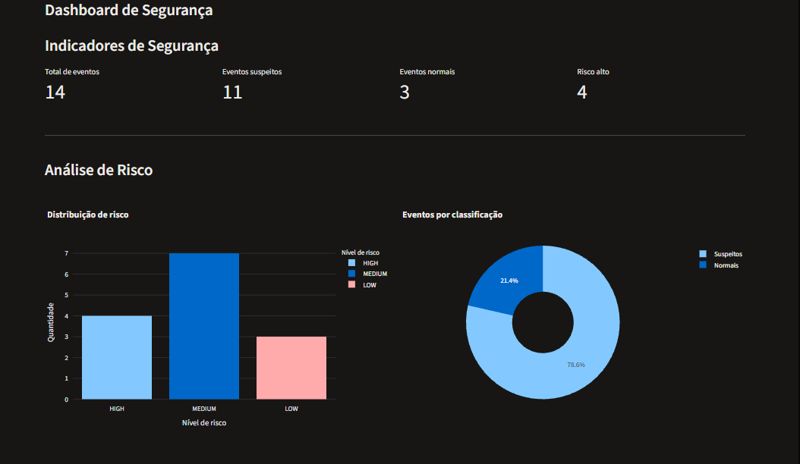
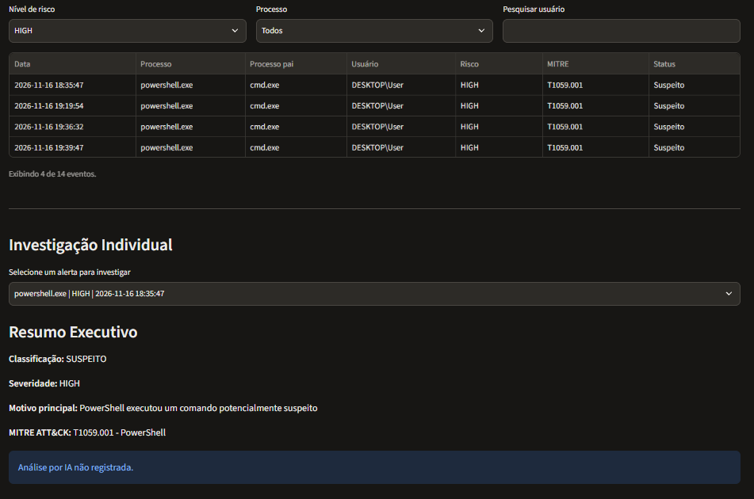
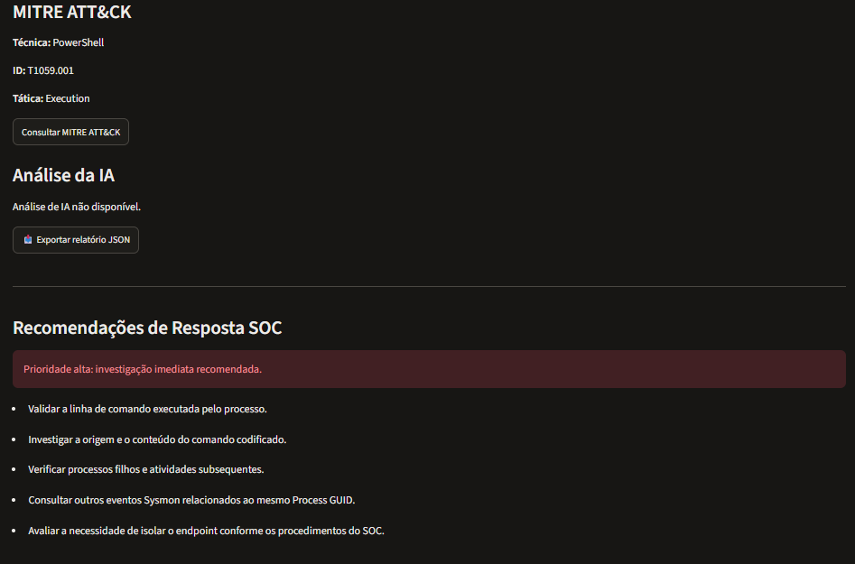

# 🛡️ AI Cyber Threat Analyzer

An intelligent cybersecurity event analysis platform designed to detect suspicious Windows processes, classify security risks, map behaviors to MITRE ATT&CK, and support SOC investigations.

## Overview

AI Cyber Threat Analyzer is a Python-based security monitoring project that processes Sysmon events using detection rules and contextual analysis prompts.

The platform combines rule-based detection, MITRE ATT&CK mapping, AI integration, JSON reporting, and an interactive SOC dashboard.

## Features

- Sysmon event ingestion and normalization
- Suspicious PowerShell command detection
- Office application process monitoring
- Risk classification (High, Medium, Low)
- MITRE ATT&CK technique mapping
- LLM integration through OpenAI API
- API failure handling
- JSON report generation
- Interactive SOC dashboard
- Alert filtering and individual investigation
- Security recommendations based on risk level
- JSON alert export
- Automated tests with Pytest

## Technologies

- Python 3.11
- FastAPI
- Streamlit
- Plotly
- Pandas
- OpenAI API
- Pytest
- MITRE ATT&CK
- Sysmon

## Architecture

```text
Sysmon Events
     |
     v
Event Reader
     |
     v
Detection Engine
     |
     v
Risk Classification
     |
     v
MITRE ATT&CK Mapping
     |
     v
AI Analysis Layer
     |
     v
JSON Report Generator
     |
     v
SOC Dashboard
```

## Risk Classification

| Risk | Description |
|---|---|
| High | Potentially suspicious command execution |
| Medium | Suspicious process relationships |
| Low | No suspicious behavior detected by current rules |

## Project Structure

```text
AI-Cyber-Threat-Analyzer/
├── analyzer/
├── api/
├── dashboard/
├── data/
├── detection/
├── reports/
├── tests/
├── main.py
├── requirements.txt
└── README.md
```

## Installation

Clone the repository:

```bash
git clone YOUR_REPOSITORY_URL
cd AI-Cyber-Threat-Analyzer
```

Create a virtual environment:

```bash
python -m venv venv
```

Activate it on Windows:

```powershell
.\venv\Scripts\Activate.ps1
```

Install dependencies:

```bash
pip install -r requirements.txt
```

Configure the OpenAI API key in a `.env` file:

```env
OPENAI_API_KEY=your_api_key
```

## Usage

Run the event analyzer:

```bash
python main.py
```

Start the API:

```bash
uvicorn api.main:app --reload
```

Start the SOC dashboard:

```bash
python -m streamlit run dashboard/app.py
```

## Testing

Run automated tests:

```bash
pytest -v
```

Current test suite: 16 passing tests.

## Security Considerations

- API keys are stored in environment variables.
- Sensitive configuration files are excluded through `.gitignore`.
- AI analysis is treated as supporting context, not proof of an attack.
- Detection results are based on the available event evidence.

## Disclaimer

This project is intended for educational and defensive cybersecurity purposes.

It is a portfolio project and is not a replacement for a production SIEM or professional incident response platform.

## Author

Cybersecurity Student | Security Operations | AI Engineering

## Dashboard Preview

### Security Overview


### Alert History and Filters


### Individual Alert Investigation
